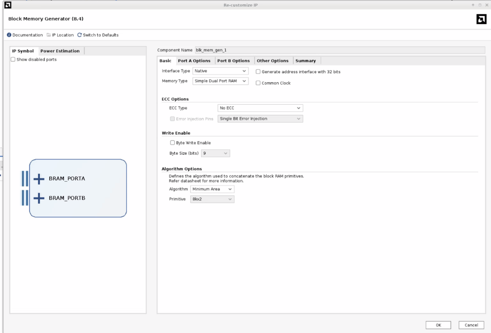
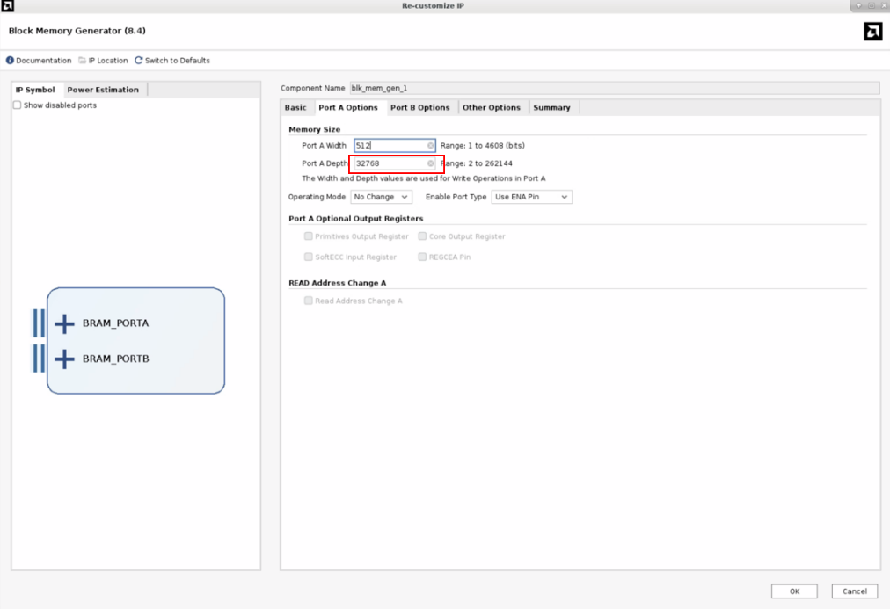
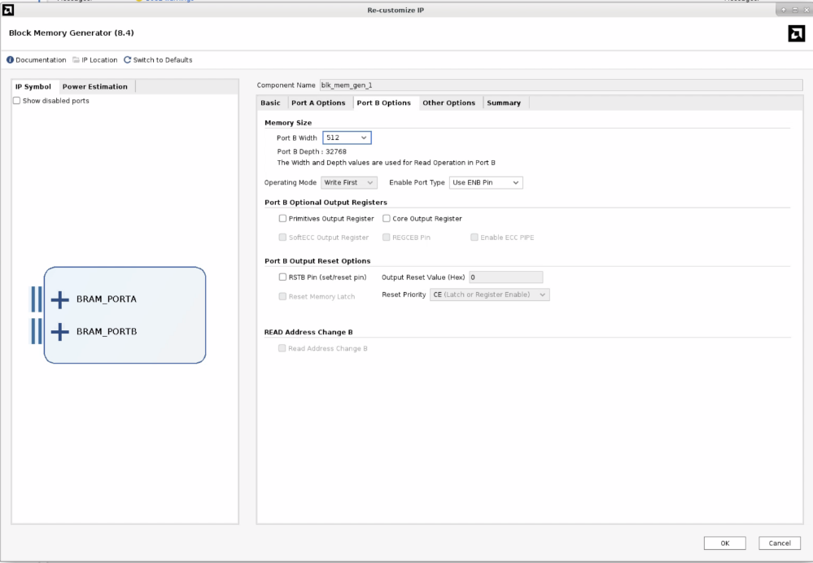
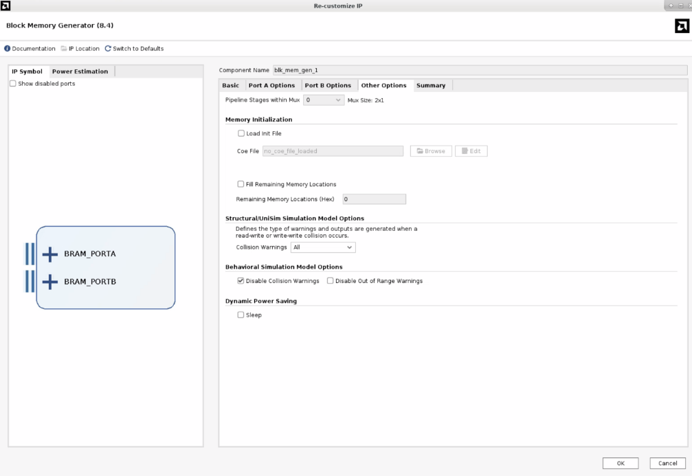

**  **

# **TinyPHY User Guide**

**  **

  - [1. 设计目标](#1-设计目标)
  - [2. 导入设计](#2-导入设计)
  - [2.1 添加tiny phy源码，将以下路径替换到真实路径](#21-添加tiny-phy源码将以下路径替换到真实路径)
  - [2.2 添加block ram IP](#22-添加block-ram-ip)
    - [Gui界面](#gui界面)
    - [脚本添加](#脚本添加)
  - [作者](#作者)
  - [LICENSE](#license)

**  **

## 1. 设计目标

基于DFI3.1协议，使用bram作为片上临时存储，实现对MC控制器读写相关命令的接收与处理，在DDR MC的设计中有效的隔离PHY造成的调试问题，实现设计环境便携化配置。

代码实例化层次结构如下：

tiny_phy/
├── tiny_phy_top.sv \# 顶层
│ ├── dfi2bram.sv \# 转换功能核心代码
│ ├── ├── dly_cycle.sv
│ ├── ├── sync_fifo_tiny.v
│ ├── blk_mem_gen_1.xci

## 2. 导入设计

## 2.1 添加tiny phy源码，将以下路径替换到真实路径

import_files -fileset sources_1 -norecurse \[list \\
"path_to_tiny_phy_top.sv / tiny_phy_top.sv" \\
"path_to_dfi2bram.sv / dfi2bram.sv" \\
"path_to_dly_cycle.sv / dly_cycle.sv" \\
"path_to_sync_fifo_tiny.v/sync_fifo_tiny.v" \\\
]
update_compile_order -fileset sources_1

## 2.2 添加block ram IP

### Gui界面

由于vivado的block ram ip受到不同版本不同板卡的限制，并且受限于板卡资源，具体工程使用的深度也会变化，因此这里只给出示例添加ip的方案。具体使用根据MC ADDRMAP以及设计资源裕量决定。按照如下进行配置：

在此处配置合适的bram深度，用来模拟ddr_phy接受dfi协议

### 脚本添加

从tcl导入：import_files -norecurse path_to_blk_mem_gen_1.xci/blk_mem_gen_1.xci

## 作者

<!-- ALL-CONTRIBUTORS-LIST:START -->
<table>
  <tr>
    <td align="center">
      <a href="https://github.com/liuchenyang456">
        
         <b>ChenYang Liu</b>
      </a>
    </td>
  </tr>
</table>

## LICENSE

Copyright © 2020-2026 Institute of Computing Technology, Chinese Academy
of Sciences.

Copyright © 2021-2026 Beijing Institute of Open Source Chip

Baiyang is licensed under [Mulan PSL v2\](LICENSE).

